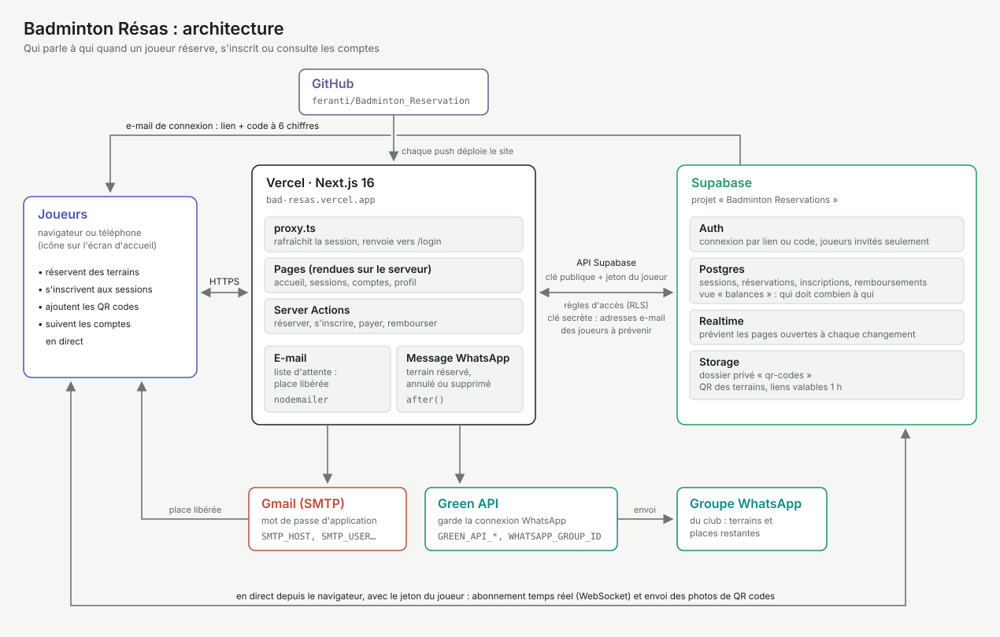

# Badminton Résas

Application web pour un groupe d'amis qui joue au badminton :

- mettre en commun les sessions, les terrains réservés (6 à 14), qui les a payés et leurs QR codes ;
- s'inscrire à une session (4 joueurs par terrain), seul ou avec des invités sans compte (+1, +2…), avec liste d'attente et e-mail quand une place se libère ;
- prévenir le groupe WhatsApp des terrains réservés ou annulés et des inscriptions ;
- tenir les comptes en temps réel (qui doit combien à qui), avec une page qui explique le calcul ;
- signaler un remboursement, que le bénéficiaire confirme.

Le site s'utilise surtout sur téléphone (icône sur l'écran d'accueil), en thème clair ou sombre.

Technologies : [Next.js](https://nextjs.org) (TypeScript, Tailwind) pour le site, [Supabase](https://supabase.com) pour la base PostgreSQL, la connexion par e-mail, le temps réel et le stockage des QR codes, [Vercel](https://vercel.com) pour l'hébergement. Les e-mails de liste d'attente partent par SMTP (Gmail) et les messages au groupe WhatsApp par [Green API](https://green-api.com).

## Architecture



- **Vercel** héberge le site Next.js. Les pages sont rendues sur le serveur et les formulaires passent par des Server Actions, qui envoient aussi les e-mails et les messages WhatsApp.
- **Supabase** fournit la connexion par lien ou code e-mail (Auth), la base Postgres avec les règles d'accès par joueur (RLS), le temps réel et le stockage privé des QR codes.
- Le **navigateur** parle directement à Supabase pour deux choses seulement : l'abonnement temps réel et l'envoi des photos de QR codes, avec le jeton du joueur.
- **Gmail (SMTP)** envoie l'e-mail « une place s'est libérée ». **Green API** envoie au groupe WhatsApp les terrains réservés ou annulés.
- **GitHub** garde le code ; Vercel reconstruit le site à chaque push.

## Avancement

| Étape | Contenu | État |
| --- | --- | --- |
| 1 | Socle : projet Next.js, schéma de la base, connexion par lien e-mail | Fait |
| 2 | Sessions partagées : plusieurs terrains par session, inscription des joueurs, temps réel | Fait |
| 3 | Comptes en temps réel, liste « qui doit à qui », remboursements confirmés | Fait |
| 3b | Sessions regroupées par créneaux, QR codes, liste d'attente et e-mail de place libérée | Fait |
| 3c | Invités (+1, +2…), messages au groupe WhatsApp, payeurs inscrits d'office, prix par défaut (9 € l'heure) | Fait |
| 3d | Durcissement de la sécurité (droits minimaux, limites en base) | Fait |
| 4 | Mise en ligne sur Vercel et invitation du groupe | En cours |

## Règles de calcul

- Une **réservation** = un terrain (6 à 14) sur un créneau. Elle est payée par un joueur, ou par deux (comme le permet le site du gymnase) : chacun avance alors la moitié du prix. On peut y joindre le QR code reçu par e-mail.
- Une **session** regroupe automatiquement les réservations d'un même gymnase dont les créneaux se suivent ou se chevauchent (par exemple 20:00 – 21:00 et 21:00 – 22:00). Une réservation à midi et une le soir font deux sessions.
- Les joueurs s'inscrivent à la session, pas à un terrain. Capacité : 4 places par terrain différent. Au-delà, les inscrits sont en **liste d'attente**, dans l'ordre d'inscription. Ceux qui paient une réservation y sont inscrits d'office.
- Un inscrit peut amener des **invités** sans compte : chacun prend une place, et l'inscrit paie leur part. Un inscrit et ses invités jouent ensemble ou attendent ensemble.
- Quand un joueur se désiste (ou qu'un terrain est ajouté), le premier de la liste d'attente passe joueur et reçoit un e-mail.
- Le prix total des réservations de la session est partagé à parts égales entre les places des joueurs effectifs, invités compris (pas la liste d'attente).
- Un remboursement compte dans les soldes une fois confirmé par celui qui le reçoit. S'il est signalé par celui qui reçoit l'argent, il est confirmé d'office.
- La page Comptes propose la liste de virements la plus courte pour remettre tout le monde à zéro.
- Solde d'un joueur = ce qu'il a avancé − sa part des soirées + remboursements envoyés − remboursements reçus. Positif : on lui doit de l'argent.

Les montants sont stockés en centimes, les heures sont saisies et affichées à l'heure de Paris. Le calcul est fait par la vue `balances` (voir `supabase/migrations/0001_init.sql`), et expliqué aux joueurs sur la page Comptes > « Comment sont calculés les comptes ? ».

## Mise en route

### 1. Créer le projet Supabase

1. Créez un compte et un projet gratuit sur [supabase.com](https://supabase.com) (région Europe, par exemple Paris ou Francfort).
2. Dans **SQL Editor**, collez et exécutez le contenu de `supabase/migrations/0001_init.sql` (bouton « Raw » de GitHub pour copier le fichier brut). Ce seul script crée toute la base : tables, vues des soldes et de la liste d'attente, règles d'accès, droits, stockage des QR codes et temps réel. Il ne s'exécute qu'une fois, sur un projet neuf. Si d'autres fichiers `0002_…`, `0003_…` existent un jour dans `supabase/migrations/`, exécutez-les ensuite dans l'ordre.
3. Dans **Authentication > Sign In / Providers**, désactivez **Allow new users to sign up** : seuls les amis invités pourront se connecter.
4. Dans **Authentication > URL Configuration**, mettez l'adresse du site dans **Site URL** (`http://localhost:3000` en local, puis l'adresse Vercel) et ajoutez-la aussi dans **Redirect URLs**.
5. Ajoutez les joueurs dans **Authentication > Users > Add user > Create new user**, en cochant **Auto Confirm User** (le mot de passe ne sert pas). Aucun e-mail n'est envoyé : chacun se connecte ensuite depuis la page de connexion du site.

Par défaut, le lien de connexion doit être ouvert dans le même navigateur que celui où on l'a demandé.

### Données de test (facultatif)

Pour essayer l'appli avec des sessions déjà remplies, exécutez `supabase/donnees-test/remplir.sql` dans **SQL Editor** : il ajoute 8 joueurs fictifs (qui ne peuvent pas se connecter), 9 sessions passées et à venir et quelques remboursements. Votre compte (le plus ancien du projet) y joue le rôle de « vous ». Tout est marqué `(test)` ou `[TEST]`, et `supabase/donnees-test/vider.sql` efface tout sans toucher aux vraies données.

Pour plus tard (étape 4) : l'envoi d'e-mails intégré à Supabase est limité à quelques messages par heure, et les modèles d'e-mail ne sont modifiables qu'avec un service d'envoi à vous. Branchez un service SMTP (Gmail avec un mot de passe d'application, Resend, Brevo…) dans **Authentication > Emails > SMTP Settings**, puis collez le contenu de `supabase/templates/magic_link.html` dans le modèle **Magic Link** : l'e-mail contiendra un lien qui marche dans n'importe quel navigateur et un code à saisir dans l'appli (pratique depuis l'icône de l'écran d'accueil).

### 2. Lancer le site en local

Il faut Node.js 20 ou plus récent.

```bash
cp .env.example .env.local   # puis remplissez avec Project Settings > API de Supabase
npm install
npm run dev
```

Ouvrez http://localhost:3000, saisissez votre e-mail et cliquez sur le lien reçu.

Pour développer sans toucher au vrai projet, on peut aussi lancer une copie locale de Supabase avec Docker : `npx supabase start` crée la base avec `supabase/migrations/`, et les e-mails de connexion arrivent sur http://127.0.0.1:54324.

### Vérifier avant de livrer

`npm run check` (Docker et Node.js requis) enchaîne le lint, les types, le build de production, remet à zéro la copie locale de Supabase, joue un test de bout en bout à deux joueurs (`tests/e2e/run.mjs`) et ouvre chaque page avec `next dev` en échouant au moindre message d'erreur.

### E-mails de liste d'attente

Ils partent d'un compte Gmail avec un **mot de passe d'application** (Compte Google > Sécurité > Validation en deux étapes activée > Mots de passe des applications). Ajoutez dans `.env.local` (et sur Vercel) :

```
SUPABASE_SECRET_KEY=...    # Supabase > Project Settings > API Keys > Secret keys
SMTP_HOST=smtp.gmail.com
SMTP_PORT=465
SMTP_USER=votre.adresse@gmail.com
SMTP_PASS=...              # le mot de passe d'application, 16 lettres
MAIL_FROM=Badminton Résas <votre.adresse@gmail.com>
```

Sans ces variables, l'appli marche normalement mais n'envoie pas d'e-mail.

### Messages au groupe WhatsApp

Chaque terrain réservé ou annulé, chaque inscription (avec ses invités) et chaque session supprimée envoie un message au groupe WhatsApp du club
(créneau, gymnase, terrains, places restantes et lien vers la session). Rien n'est envoyé pour une session déjà passée.
L'envoi passe par [Green API](https://green-api.com), qui garde la connexion d'un numéro WhatsApp (de préférence
un numéro dédié, membre du groupe) : l'appli n'a rien à héberger.

1. Sur green-api.com, créez une instance (l'offre gratuite Developer suffit) et scannez son QR code avec le WhatsApp du numéro.
2. Récupérez l'identifiant du groupe (`...@g.us`), par exemple avec la méthode `getChats` de Green API.
3. Ajoutez dans `.env.local` (et sur Vercel) :

```
GREEN_API_URL=https://7105.api.greenapi.com   # « apiUrl » affiché sur la page de l'instance
GREEN_API_INSTANCE=7105000000                 # idInstance
GREEN_API_TOKEN=...                           # apiTokenInstance
WHATSAPP_GROUP_ID=120363000000000000@g.us
```

Sans ces variables, les messages sont seulement écrits dans le journal du serveur.

### 3. Mettre en ligne sur Vercel

1. Sur [vercel.com](https://vercel.com), importez ce dépôt GitHub.
2. Ajoutez les variables `NEXT_PUBLIC_SUPABASE_URL` et `NEXT_PUBLIC_SUPABASE_PUBLISHABLE_KEY`, et celles des e-mails de liste d'attente et de WhatsApp si vous les utilisez (voir ci-dessus).
3. Déployez, puis reportez l'adresse obtenue dans la configuration Supabase (étape 1.4).

## Modifier la base

La base d'un projet neuf est créée par le seul script `supabase/migrations/0001_init.sql` (il regroupe les anciennes migrations 0001 à 0009). Pour toute modification ultérieure, ajoutez un nouveau fichier `supabase/migrations/0002_nom.sql` (puis `0003`…) sans retoucher les précédents, exécutez-le dans **SQL Editor** du projet en ligne, et pensez aux règles RLS et aux `grant` pour `authenticated` de toute nouvelle table : le projet en ligne n'ouvre pas les tables à l'API par défaut.

## Structure

```
supabase/migrations/       0001_init.sql : création complète de la base (tables, vues, règles d'accès, droits, temps réel)
supabase/donnees-test/     Jeu de données factice : remplir.sql et vider.sql
supabase/templates/        Modèle de l'e-mail de connexion (lien + code)
supabase/config.toml       Réglages de la copie locale de Supabase (npx supabase start)
scripts/check.sh           Vérification complète avant livraison (npm run check)
tests/e2e/                 Test de bout en bout à deux joueurs et visite de toutes les pages
src/proxy.ts               Rafraîchit la session et renvoie vers /login si besoin
src/lib/supabase/          Clients Supabase (navigateur, serveur, proxy)
src/lib/data.ts            Lecture des sessions, réservations et joueurs
src/lib/notify.ts          E-mail aux joueurs qui sortent de la liste d'attente
src/lib/whatsapp.ts        Envoi d'un message au groupe WhatsApp par Green API
src/lib/format.ts          Montants, dates et heure de Paris
src/lib/courts.ts          Numéros des terrains du gymnase
src/app/page.tsx           Accueil : sessions à venir ou passées
src/app/sessions/          Nouvelle réservation, détail d'une session, page Gérer et actions (ajout, inscription, invités, QR code…)
src/app/comptes/           Soldes, « qui doit à qui », remboursements à signaler et confirmer, page d'aide sur le calcul
src/lib/settle.ts          Calcul des virements pour équilibrer les comptes
src/app/profil/            Changer son nom affiché et le thème (clair, sombre ou celui du téléphone)
src/app/login/             Connexion par lien ou code reçu par e-mail
src/app/auth/confirm/      Arrivée du lien de connexion
docs/architecture.svg      Schéma de l'architecture (ci-dessus)
src/components/            Éléments d'interface (carte de soirée, formulaires, temps réel)
```
